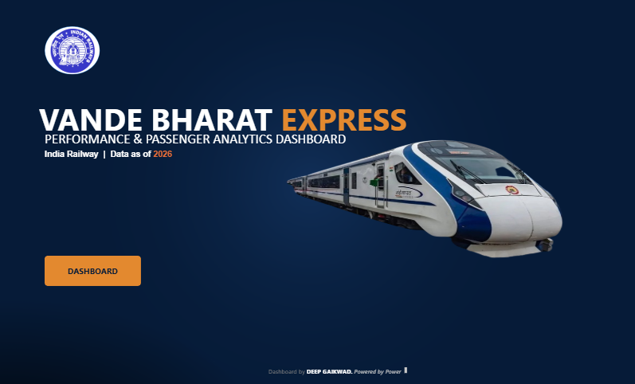

# 🚄 VANDE BHARAT EXPRESS
## Performance & Passenger Analytics Dashboard

**An Interactive Power BI Data Analytics Project**


---

## 📌 PROJECT OVERVIEW

The Vande Bharat Express Performance & Passenger Analytics Dashboard is an interactive Power BI project designed to analyze train operations, passenger demand, revenue generation, occupancy, and punctuality.

The project transforms a synthetic railway booking dataset into an interactive analytical report that helps explore performance across trains, routes, states, and passenger categories.

The dashboard provides a consolidated view of important operational and business metrics through KPI cards, trend analysis, comparisons, and interactive filters.

**Dataset Coverage**
- 164 Trains
- Approximately 100,000 Booking Records
- 23 States
- 5 Regions
- January – May 2026

> **Important:** This project uses synthetic data created for portfolio and educational purposes. It is not official Indian Railways data.

---

## 🖼️ DASHBOARD PREVIEW

### Home Page


### Dashboard Overview


*If your image files have a different extension, update `.png` in the image paths to match the actual filenames.*

---

## 📊 KEY PERFORMANCE INDICATORS

| KPI | Dashboard Value |
|---|---:|
| Total Trains | 164 |
| Total Passengers | 23.72M |
| Average Occupancy | 78.77% |
| Average Speed | 76.61 |
| On-Time Performance | 83.77% |
| Total Revenue | ₹36.11bn |

*Values represent the dashboard's displayed figures and may change when filters are applied.*

---

## ✨ DASHBOARD FEATURES

### 1. KPI Overview
A consolidated view of major performance indicators:
- Total Trains
- Total Passengers
- Average Occupancy
- Average Speed
- On-Time Performance
- Total Revenue

### 2. Passenger & Revenue Analysis
- Monthly passenger trends
- Monthly revenue trends
- Passenger demand patterns
- Revenue performance analysis

### 3. Route Performance Analysis
- Route-wise passenger distribution
- Route-wise revenue comparison
- Average occupancy by route
- Identification of high-performing routes

### 4. Class-Wise Analysis
- Passenger distribution by class
- Executive Class and Chair Car comparison
- Class-wise demand analysis

### 5. Train Performance Analysis
- Train-wise passenger volume
- Revenue comparison
- Average speed
- Occupancy performance
- Delay analysis

### 6. Punctuality Analysis
- On-time performance percentage
- Average delay in minutes
- Comparison against the defined on-time target

### 7. Performance Leaderboards
The dashboard highlights:
- Highest Revenue Route
- Busiest Train
- Best Occupancy Route
- Highest Speed Train
- Least Average Delay Train

### 8. Interactive Slicers
Users can explore the dashboard through available filters:
- State
- Route
- Train Name
- Train Number
- Coach Type
- Class
- Journey Date
- Month
- Passenger Type
- Gender

---

## 🧱 DATA MODEL

The project uses three primary tables:

| Table | Description |
|---|---|
| Fact_Bookings | Booking records and train performance metrics |
| Train_Master | Train reference information |
| State_Master | State and regional information |

### Relationships

| Fact Table | Dimension Table | Relationship |
|---|---|---|
| Fact_Bookings[Train_No] | Train_Master[Train_No] | Many-to-One |
| Fact_Bookings[State] | State_Master[State] | Many-to-One |

The model follows a star-schema approach with single-direction filtering from dimension tables to the fact table, as documented in the project methodology.

---

## 🧮 DAX & MEASURES

DAX measures are used to calculate the dashboard KPIs and analytical values.

Example measures:

```dax
Total Trains =
DISTINCTCOUNT ( Fact_Bookings[Train_No] )

Total Passengers =
SUM ( Fact_Bookings[Passengers] )

Total Revenue =
SUM ( Fact_Bookings[Revenue] )

Avg Occupancy =
AVERAGE ( Fact_Bookings[Occupancy_%] )

Avg Speed =
AVERAGE ( Fact_Bookings[Speed_kmph] )

Avg Delay (mins) =
AVERAGE ( Fact_Bookings[Delay_Minutes] )
```

For the complete DAX documentation, refer to:

`docs/DAX_measures.md`

---

## 🛠️ TOOLS & TECHNOLOGIES

| Technology | Purpose |
|---|---|
| Power BI Desktop | Dashboard development and visualization |
| Microsoft Excel | Dataset management |
| Power Query | Data cleaning and transformation |
| DAX | Measures and KPI calculations |
| GitHub | Project documentation and version control |

---

## 📂 PROJECT STRUCTURE

```text
Vande-Bharat-Express-Performance-Dashboard/
│
├── LICENSE
├── .gitignore
├── README
│
├── VandeBharat_Dashboard_Dataset.xlsx
│
├── Vande Bharat Express Performance &
│   Passenger Analytics Dashboard.pbix
│
├── docs/
│   ├── DAX_measures.md
│   └── methodology.md
│
└── Images/
    ├── Home.png
    └── Dashboard.png
```

*The image extensions and documentation filenames shown above should match the actual files in your folders.*

---

## 🚀 HOW TO EXPLORE THE PROJECT

1. Clone or download this GitHub repository.
2. Open the Power BI `.pbix` file using Power BI Desktop.
3. Explore the dashboard's KPI cards and visualizations.
4. Use the slicers to filter data by route, train, state, class, and date.
5. Review `docs/` for DAX measures and methodology documentation.
6. Use the Excel dataset to understand the source tables.

### Rebuilding the Report

1. Open Power BI Desktop.
2. Select **Get Data → Excel Workbook**.
3. Load the required dataset tables.
4. Verify the relationships in Model View.
5. Create the documented DAX measures.
6. Rebuild the visuals and apply the report design.

---

## ⚠️ LIMITATIONS & DISCLAIMER

- The dataset is synthetic and is not sourced from official Indian Railways systems.
- Dashboard results depend on the dataset, calculations, and active filters.
- The on-time flag uses a fixed threshold in the source data.
- Class and Coach_Type are documented as duplicate fields in the current dataset.
- Some Power BI map visuals may require migration to a supported alternative in a future version.

---

## 🔮 FUTURE ENHANCEMENTS

- Region-level performance analysis
- Year-over-year comparison
- Configurable delay threshold using What-If parameters
- Row-Level Security by region
- Additional operational performance indicators

---

## 👤 AUTHOR

**Deep Gaikwad**

Aspiring Data Analyst

**Skills:** Power BI | SQL | Excel | Python | Data Analysis

GitHub: https://github.com/deep-gaikwad

---

## 📄 LICENSE

This project includes a LICENSE file in the repository.

Please refer to the LICENSE file for the applicable terms and preserve the original copyright attribution unless you own the project and have the right to change it.

---

<div align="center">

**Thank you for visiting this project!**

*Turning data into meaningful insights with Power BI.*

</div>
